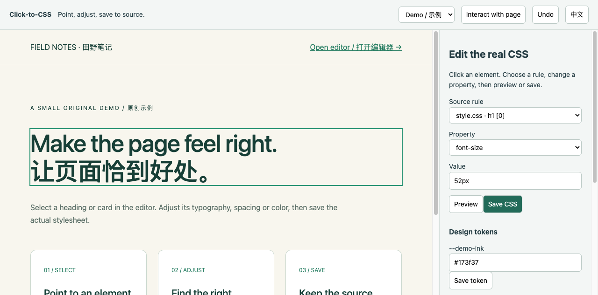

# Click-to-CSS · 点选式网页样式编辑器

[English](README.md) · [简体中文](README.zh-CN.md)

[](https://github.com/workstonedai-collab/click-to-css/actions/workflows/ci.yml) · [MIT](LICENSE) · Node.js 22.12+

**Point at an element, adjust its style, and save the change back to your CSS source.**

Click-to-CSS is a local Vite plugin for the last mile of styling: a heading needs a little more space, a card feels too dense, or a color needs adjusting. Open your static page in the editor, select a matching source rule, preview a value, and write the change to the existing stylesheet. You can inspect the source change and undo it before committing with your normal Git workflow.

It is useful for developers, designers working on their own HTML/CSS, and people refining pages created with a coding agent. No account, model API or cloud service is needed.

For static HTML and ordinary external CSS. React/Vue source mapping, Tailwind and CSS-in-JS are not supported yet.

## See it in action


[Watch the full 30-second video](docs/demo.mp4) · [Step-by-step walkthrough](docs/walkthrough.en.md) · [中文教程](docs/walkthrough.zh-CN.md)

The recording shows the included static page: select a heading, preview 46px, save to real CSS, inspect the source and undo. No account or API key is needed.



## Try the included page

Requires Node.js **22.12 or newer**. In the downloaded project folder:

```sh
git clone https://github.com/workstonedai-collab/click-to-css.git
cd click-to-css
npm ci
npm run dev
```

Open the local URL printed by Vite and add `/__click_to_css` (normally `http://127.0.0.1:5173/__click_to_css`).

1. Click the large heading in the preview.
2. Select its `h1` rule and choose `font-size`.
3. Enter `46px` and click **Preview**.
4. Click **Save CSS**. The real `style.css` changes; the sidebar shows before and after.
5. Click **Undo** to restore it. Review changes in your preferred Git client.

Switch **中文 / English** in the toolbar. **Interact with page** temporarily lets clicks reach links and controls so you can reveal tabs or dialogs before selecting their elements.

## Contents

- [When it is useful](#when-it-is-useful)
- [Try the included page](#try-the-included-page)
- [What is included?](#what-is-included)
- [Use it with your own static page](#use-it-with-your-own-static-page)
- [Connect an existing folder without moving its source](#connect-an-existing-folder-without-moving-its-source)
- [Troubleshooting](#troubleshooting)
- [Scope and current limits](#scope-and-current-limits)
- [Verification and development](#verification-and-development)
- [Let your coding agent help](#let-your-coding-agent-help)
- [Contributing and license](#contributing-and-license)

## When it is useful

- **Finish an agent-generated landing page:** adjust headings, card spacing and colors while looking at the actual page.
- **Tune a small static site:** inspect the matching CSS rule instead of guessing which selector controls an element.
- **Review a design change with a developer:** save ordinary source changes that can be inspected in Git and carried into the normal build.

The working loop is **select → choose source rule → preview → save → review**. Previewing affects the selected element temporarily; saving updates its shared CSS rule and can affect other matching elements.

## What is included?

| Capability | Behavior |
| --- | --- |
| Element selection | Lists matching rules from the page's configured external CSS files |
| Source rule choice | Distinguishes repeated selectors, including those inside active media queries |
| Style editing | Supports typography, spacing, color, dimensions, borders and selected layout properties |
| Design tokens | Updates existing configured CSS custom properties |
| Preview | Applies an element-level preview without writing files |
| Save | Uses PostCSS to update the selected source declaration |
| Undo | Restores the previous source only if it has not changed outside the editor |
| Change protection | Rejects saving over a newer source snapshot |

Undo history lasts for the current development-server session and retains up to 100 edits. Git provides longer-term history. A saved shared selector can affect more than one element; the selected source rule is the unit of change.

## Use it with your own static page

Add the plugin to your Vite configuration and list only the files you want editable:

```js
import { defineConfig } from 'vite';
import { clickToCss } from './src/index.js';

export default defineConfig({
  plugins: [clickToCss({
    pages: [{
      file: 'index.html',
      label: 'Home',
      styles: ['styles/page.css', 'styles/tokens.css'],
    }],
    tokenFile: 'styles/tokens.css',
    tokenPrefix: '--theme-',
  })],
  server: { host: '127.0.0.1' },
});
```

Paths are relative to the Vite project root. Styles should be ordinary same-origin `<link rel="stylesheet">` files. Use a dedicated file for editable tokens. Token edits can change the whole site, so review them before committing.

## Connect an existing folder without moving its source

A convenient layout is to keep this clone next to your static site:

```text
workspace/
  click-to-css/       # this tool, including its dependencies
  my-page/
    index.html
    styles/page.css
    styles/tokens.css
```

In the tool's `vite.config.js`, set Vite's `root` to your page folder. Keep the plugin import pointing to the tool's `src/index.js`:

```js
import path from 'node:path';
import { defineConfig } from 'vite';
import { clickToCss } from './src/index.js';

export default defineConfig({
  root: path.resolve('../my-page'),
  plugins: [clickToCss({
    pages: [{ file: 'index.html', label: 'My page',
      styles: ['styles/page.css', 'styles/tokens.css'] }],
    tokenFile: 'styles/tokens.css',
    tokenPrefix: '--theme-',
  })],
  server: { host: '127.0.0.1' },
});
```

Run `npm run dev` **from the tool folder**. Your HTML must link those stylesheet files. All configured HTML/CSS paths are relative to `my-page`, the Vite root. List multiple pages to use the page selector. Omit `tokenFile` when you do not need token editing. A token prefix limits which existing custom properties appear in the editor.

After saving, review your site's changes, for example with `git -C ../my-page diff`. The tool does not create commits or start deployments.

## Troubleshooting

| Symptom | What to check |
| --- | --- |
| The editor URL returns 404 | Run the development server with the plugin enabled, then open the printed port plus `/__click_to_css`; a static production host does not provide the editor |
| An element has no source rules | Use ordinary external CSS, list the file under the selected page's `styles`, and verify that the selector matches |
| The selected property has an empty value | That rule may not declare it; choose another source rule or add a supported property |
| Save reports a conflict | Another editor changed the file; reload the editor, inspect the latest source, then apply the intended edit again |
| Undo is refused | The current file differs from the saved result; preserve the newer edits and use Git/manual review |
| A CSS value is rejected | Use a plain supported value; URL imports, declaration separators and executable expressions are outside the editable value set |
| A token is absent | Check `tokenFile`, the property name and `tokenPrefix`; new token creation is not included |

## Scope and current limits

- This release targets **static HTML and ordinary external CSS**. React/Vue component source mapping, Tailwind classes, CSS-in-JS and remote stylesheets are not implemented.
- CSS imports, generated/virtual styles and complex CSS nesting may not map directly to a source rule. Keep editable files simple and inspect the selected rule.
- The API is enabled only by Vite's `serve` mode and requires loopback requests; writes require the same origin. Files escaping the project through a symlink are rejected.
- Run on a trusted local project. Other processes on your machine can still edit those files. Do not expose the editor as an online multi-user service.
- It does not commit, push or deploy for you. Production builds contain the example page, not this development editor.

## Verification and development

```sh
npm test
npm run build
```

Tests exercise repeated rule selection, token boundaries, value checks, real HTTP saves, external-change conflicts and undo. CI is configured for Node 22/24 on Linux, macOS and Windows. The included screenshot comes from an actual local browser run; it is not a mock UI.

Source: `src/index.js` (plugin and writes), `src/ui/` (editor), `vite.config.js` (demo configuration), `test/` (checks).

## Let your coding agent help

Ask your agent to inspect your static page, list its HTML and external CSS files in the plugin configuration, start the local editor, and help you review the final source diff. You keep control of the files and Git changes.

## Contributing and license

Small reproducible examples are welcome; see [CONTRIBUTING.md](CONTRIBUTING.md). Project code is licensed under [MIT](LICENSE). Third-party dependencies and data retain their own terms.
