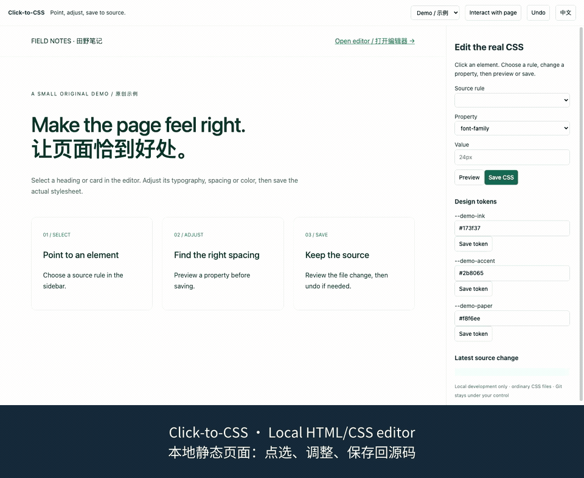
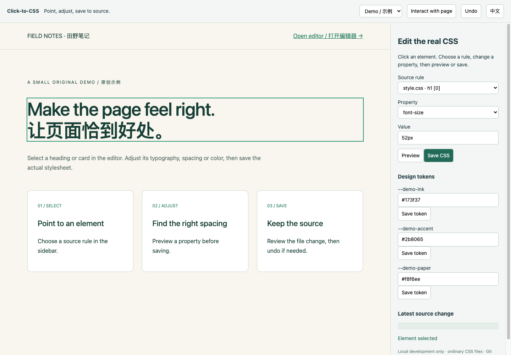
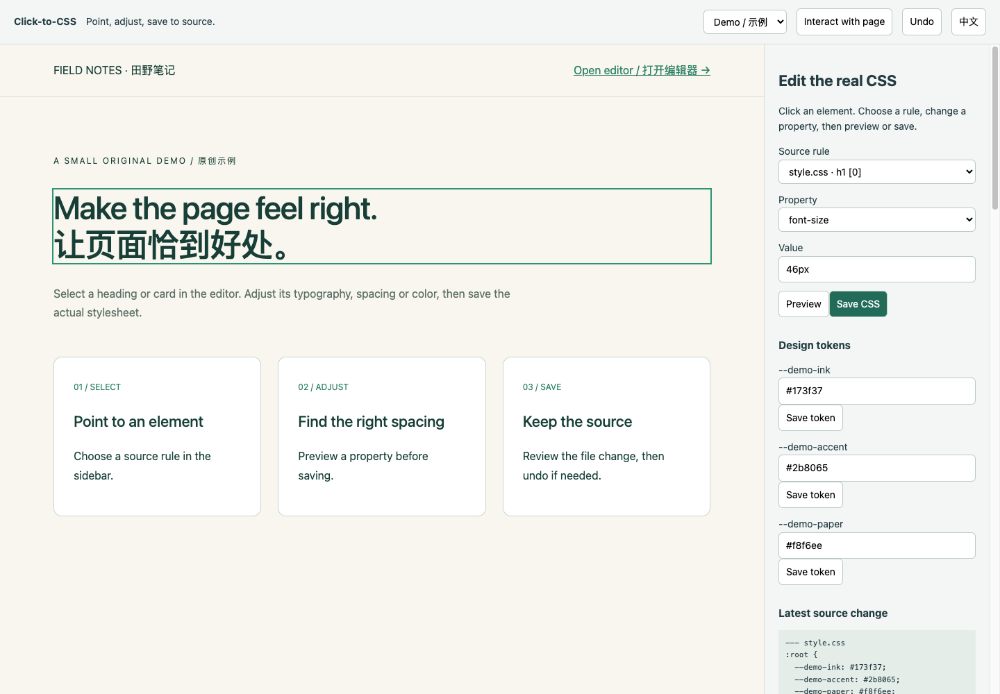

# From a click to a CSS source change

[简体中文](walkthrough.zh-CN.md) · [Project overview](../README.md)

**Try a real edit in the included static page, then undo it.** You need Node.js 22.12+, a browser, and about five minutes. No account, AI service, or API key is required.



[Watch the full 30-second recording](demo.mp4) · [Bilingual subtitles](demo.srt)

The GIF is a compact preview at 2× speed. The MP4 retains the original timeline and includes English and Chinese captions. Both show the actual editor and the original example page; the captions were added after recording.

## 1. Start the included example

```sh
git clone https://github.com/workstonedai-collab/click-to-css.git
cd click-to-css
npm ci
npm run dev
```

Open the address printed by Vite and add `/__click_to_css`, normally `http://127.0.0.1:5173/__click_to_css`. If the port is occupied, use the port Vite actually prints. Keep the server local.

## 2. Select the heading

Click **Make the page feel right. / 让页面恰到好处。** in the left preview. In the right sidebar:

- Source rule: `style.css · h1 [0]`.
- Property: `font-size`.
- Initial value: `52px`.



The demo viewport is wide enough for the desktop rule. Below 800px, its media query uses `34px`; use a wider window to reproduce the same values.

## 3. Preview 46px

Enter `46px` and click **Preview**. The selected heading changes, while the source file remains unchanged. You can try a different value before saving.

## 4. Save the change

Click **Save CSS**. The plugin updates the selected `h1` declaration in the real `style.css`. The page reloads, so selection is cleared; click the heading again if you want to inspect its new value.

Check the source:

```sh
git diff -- style.css
```

The relevant change is:

```diff
 h1 {
-  font-size: 52px;
+  font-size: 46px;
```



Saving changes a shared rule; every element matching that rule can be affected. Review the diff before committing.

## 5. Undo and confirm

Click **Undo**. The original heading size returns. Run `git diff -- style.css` again: it should show no changes if you began with a clean file and followed only these steps.

Undo belongs to the current server session. If another editor changes the file, the tool refuses to overwrite that newer content. Use Git or manual review for longer-term history.

## Use your own page next

Follow the [existing-folder guide](../README.md#connect-an-existing-folder-without-moving-its-source). Register only the HTML and ordinary external CSS files you want editable. This version does not map React/Vue component source, Tailwind classes, or CSS-in-JS.

## Give this task to your coding agent

> Clone Click-to-CSS into a separate folder. Check Node.js is 22.12 or newer, install the locked dependencies, and start the local example. Give me the exact editor URL. Guide me through selecting the heading, previewing 46px, saving, and undoing. Confirm that preview did not change the source, saving changed style.css, and undo restored it. Use only the included fictional example. For my own site, inspect its HTML/CSS and explain the allowlist configuration before making changes.

## Recording verification

Recorded on 2026-10-06 with version 0.1.0 at a 1440×1000 viewport. The source was checked after each operation: preview left it unchanged, saving wrote `46px`, and undo restored the original bytes. Existing tests (5) and the production build passed. The recording covers this static example; it is not a compatibility claim for other frameworks.
